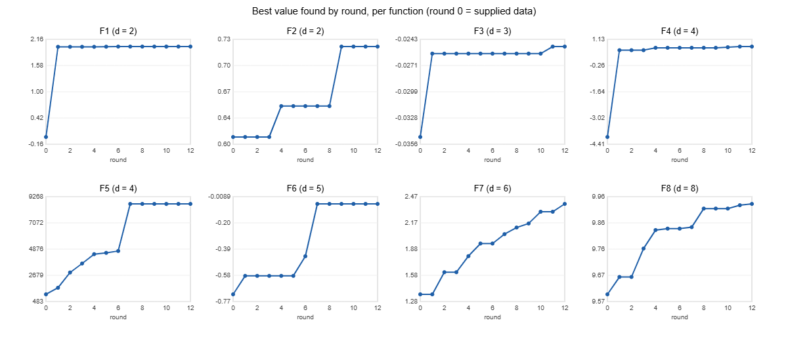

# Black-box optimisation of eight unknown functions

Imperial College London PCMLAI capstone · Johan Landman

**Start here:** [notebook walkthrough](notebooks/BBO_capstone_walkthrough.ipynb) ·
[datasheet](docs/datasheet.md) · [model card](docs/model_card.md) ·
[presentation (PDF)](docs/BBO_capstone_presentation_Johan_Landman.pdf) ·
[retrospective](docs/reflections/retrospective_25_1.md)

## NON-TECHNICAL EXPLANATION OF YOUR PROJECT

Imagine eight machines with hidden dials and no instruction manual. Each week I could set the dials on
each machine once and see a single score, and the aim was to find the settings that give the highest
score using only about thirteen tries per machine. I used a statistical model that learns from every
result to suggest the next setting, then checked each suggestion against a written prediction. Two
machines were solved exactly, and most others improved sharply: one moved from a score of −4 to +0.74.
The main lesson was to test a promising result again before trusting it, because some machines give
noisy readings.

## DATA

- **Source:** the eight functions, the initial data points and the weekly results come from the
  Imperial College PCMLAI capstone challenge portal. They are synthetic functions owned by the
  programme; the challenge brief describes each one as a stand-in for a real problem (radiation source
  detection, a noisy log-likelihood, drug discovery, warehouse placement, chemical yield, a recipe and
  two machine-learning models).
- **Size:** 175 supplied points plus 12 rounds × 8 portal queries (inputs in [0, 1]^d, d = 2 to 8; one
  output each). Under 1 MB, so all data are stored here; no external datasets are needed.
- **Layout:**
  - `data/raw/initial/` — supplied NumPy arrays, never edited.
  - `data/raw/portal/` — the portal's cumulative `inputs.txt` and `outputs.txt`, never edited.
  - `data/processed/` — one CSV per function, regenerated by `python src/build_dataset.py`.
- **Documentation:** the [datasheet](docs/datasheet.md) answers the template questions for every function.

## MODEL

A **Gaussian process (GP)** surrogate per function (scikit-learn), with one lengthscale per input
so the model also shows which inputs matter. I chose it because:
- it gives a prediction *and* an uncertainty, which is what deciding where to query next needs;
- it works with tens of points, where most ML models need thousands;
- it is transparent enough to check against every result.

On top of the GP sits a simple policy layer. Each round, each function is classified as solved, noisy,
still improving or converged, and the class picks the move:
- resubmit a known optimum;
- repeat a point to measure noise;
- take a GP-guided step;
- move one coordinate to a fitted peak.

The [model card](docs/model_card.md) has the details, limitations and trade-offs.

## HYPERPARAMETER OPTIMSATION

- **GP kernel settings:** the kernel family (RBF or Matérn-5/2) and the lower bound on the lengthscales
  (0.03, 0.06, 0.15 or 0.30) are chosen per function by **5-fold cross-validated RMSE**
  (`src/tune.py`), re-run every round from round 7. Matérn won on five of eight functions, and the best
  and worst settings differed by up to 1.7× in held-out error.
- **Kernel hyperparameters** (amplitude, lengthscales, noise level) are fitted by maximum likelihood with
  25 restarts and a fixed seed.
- **Acquisition hyperparameters:** the UCB exploration weight β was set between 0.5 and 0.8 early and
  reduced to zero, pure exploitation, in the final round. The trust-region radius shrank from 0.15 to
  0.03 as functions converged.

## RESULTS



| Fn | d | Best in supplied data | Best found | Status |
|---|---|---|---|---|
| F1 | 2 | ≈ 0 | **2.000** | Solved (Gaussian peak); noise-free |
| F2 | 2 | 0.611 | **0.726** | Noisy ridge; four repeats average 0.608 |
| F3 | 3 | −0.0348 | **−0.0250** | Flat and noisy near the peak |
| F4 | 4 | −4.03 | **0.744** | Very sharp single peak, bracketed |
| F5 | 4 | 1,089 | **8,662** | Solved: optimum at the corner (1, 1, 1, 1) |
| F6 | 5 | −0.714 | **−0.061** | Narrow, noisy peak |
| F7 | 6 | 1.365 | **2.390** | Still improving at the end |
| F8 | 8 | 9.598 | **9.930** | Converged locally |

What the model taught:
- **Noise first.** Exact repeats showed F2, F3 and F6 are noisy. Three earlier curve fits had been fitted
  to noise; after that, decisions on those functions used averages.
- **Few inputs matter.** F2 depends almost only on x1, F3 on x3, and three of F8's eight inputs carry
  about 70% of the relevance.
- **One coordinate at a time.** Joint six- and eight-dimensional GP steps failed; single-coordinate moves
  were reliable.
- **Hypotheses can beat the model.** The largest gain (F5, +84%) came from testing whether the optimum
  was at the corner, a move the cautious GP would not have proposed.

## Reproduce

```bash
pip install -r requirements.txt
python src/build_dataset.py                       # raw files -> data/processed/
cd notebooks && jupyter notebook BBO_capstone_walkthrough.ipynb
```

The notebook rebuilds the summary, the progress chart, the GP relevance table, the noise and prediction
tables, and regenerates the final round-13 queries, asserting that they match the submitted file. Each
round's exact query script is in `rounds/weekNN/`. Its docstring records the previous round's predictions
against actual results, plus the policy for the new round. From week 10 onwards the scripts read
`data/processed/` directly; weeks 6–9 read a `data_wN/` snapshot of the same rows, truncated to that round.

## Repository layout

```
README.md
LICENSE
requirements.txt
notebooks/BBO_capstone_walkthrough.ipynb   method and results, end to end (executed, with outputs)
data/raw/initial/function_<i>/             supplied initial design (.npy), never edited
data/raw/portal/                           portal inputs.txt / outputs.txt, never edited
data/processed/                            function_<i>.csv and summary.csv (generated)
src/build_dataset.py                       raw -> processed, with shape and range checks
src/tune.py                                per-function GP kernel selection by 5-fold CV
src/validate_query.py                      checks a round's queries against the portal format
rounds/week06 ... week13/                  each round's query script, queries and reflections
docs/datasheet.md                          per-function datasheet (Module 25 template)
docs/model_card.md                         model card (Module 25 template)
docs/references.md                         design decisions mapped to sources and code
docs/reflections/                          final retrospective
docs/images/                               figures used in this README
docs/archive/                              earlier versions of the datasheet and model card
docs/BBO_capstone_presentation_Johan_Landman.pdf
```

## CONTACT DETAILS

Johan Landman — [GitHub @jhnlandman-sudo](https://github.com/jhnlandman-sudo). Questions and suggestions
are welcome as GitHub issues on this repository.

## Licence

Code and documentation: MIT licence (see [LICENSE](LICENSE)). The challenge functions and initial data
belong to the Imperial College PCMLAI programme and are included for educational use only.
